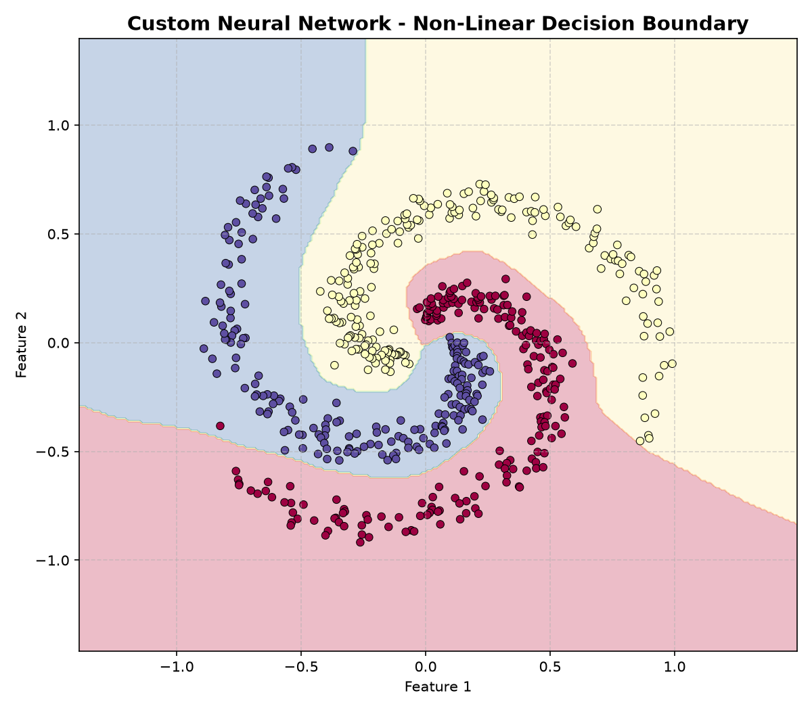
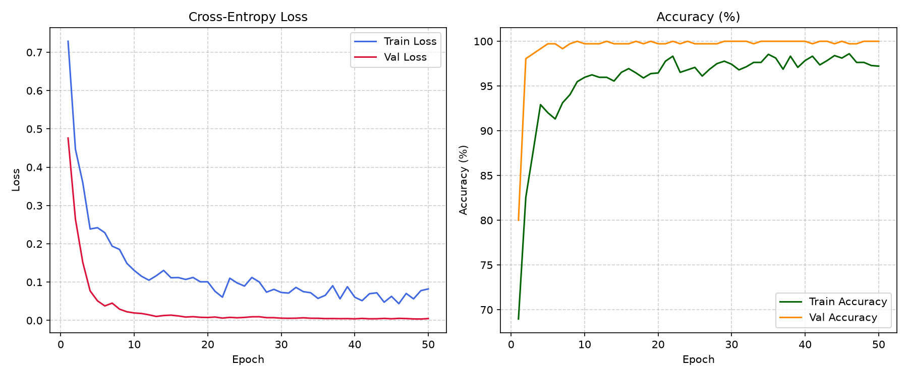

# OMEGA NEURAL NETWORK ENGINE

[](https://www.python.org/downloads/)
[](https://pytorch.org/)
[](LICENSE)
[](tests/)
[](test.py)

**OMEGA NEURAL NETWORK ENGINE** is a modular deep learning development and training framework designed as the core machine learning foundation of the sovereign OMEGA AI ecosystem.

It provides reusable layers, activations, loss functions, optimizers, learning rate schedulers, a pure Python/NumPy educational autograd engine, declarative YAML/JSON model building, real training pipelines with early stopping, experiment tracking in SQLite, and a futuristic glassmorphic training dashboard.

<p align="center">
  
  
</p>

---

## 1. Architectural Overview

```
                 OMEGA NEURAL NETWORK ENGINE
                              |
      +-----------------------+-----------------------+
      |                                               |
[Futuristic Web Dashboard]                   [Modular CLI Interface]
http://127.0.0.1:8500                        python main.py <command>
      |                                               |
      +-----------------------+-----------------------+
                              |
                   [Tensor & Compute Core]
              (CUDA, Apple MPS, CPU Detection)
                              |
      +-----------------------+-----------------------+
      |                                               |
[PyTorch Production Engine]             [Educational Autograd]
- Autograd Automatic Diff               - Pure Python / NumPy Graph
- Mixed Precision (AMP)                 - Topological Backpropagation
- Gradient Clipping (1.0)               - Exact Gradient Comparison
- AdamW, Adam, SGD, RMSprop             - Numerical Validation (1e-16)
                              |
      +-----------------------+-----------------------+
      |                                               |
[18 Modular Layer Types]                [Declarative Model Builder]
- Dense / Linear                        - YAML / JSON Topology Spec
- Conv1D, Conv2D, Deconv                - Dynamic Layer Resolution
- Pooling (Max, Avg, Adaptive)          - Dimensionality Inference
- Norms (Batch, Layer, RMSNorm)         - Param & Size Verification
- Recurrent (RNN, LSTM, GRU)
- Attention & TransformerBlocks
                              |
      +-----------------------+-----------------------+
      |                                               |
[Training & Evaluation Engine]          [Persistence & Ecosystem]
- Stratified Dataset Splitting          - Safe Checkpoint Manager
- Early Stopping & Epoch Loops          - SQLite Experiment Registry
- Macro Precision/Recall/F1             - OMEGA GPT-1 Bridge
- Metric History Tracking               - OMEGA MODEL 2 Bridge
```

---

## 2. Framework Components

### A. Modular Layer System (`layers/`)
- **Dense / Linear**: Configurable Kaiming, Xavier, Normal, or Zero initialization.
- **Embeddings**: Vocabulary `TokenEmbedding`, `LearnedPositionalEmbedding`, `SinusoidalPositionalEmbedding`.
- **Convolutions**: `Conv1D`, `Conv2D`, `ConvTranspose2D`.
- **Pooling**: `MaxPool1D`, `MaxPool2D`, `AvgPool2D`, `AdaptiveAvgPool2D`.
- **Normalization**: `BatchNorm1D`, `BatchNorm2D`, `LayerNorm`, `RMSNorm` (Llama/Mistral style), `Dropout`.
- **Recurrent**: `RNN`, `LSTM`, `GRU` with multi-layer and bidirectional support.
- **Attention**: `MultiHeadAttention` (PyTorch Flash SDPA), `TransformerBlock` (Pre-LN), `ResidualConnection`.

### B. Activation & Loss Functions (`activations/`, `losses/`)
- **Activations**: `ReLU`, `LeakyReLU`, `GELU`, `SiLU / Swish`, `Sigmoid`, `Tanh`, `Softmax`, `ELU`.
- **Loss Functions**: `CrossEntropy`, `BinaryCrossEntropy`, `MSE`, `MAE / L1`, `Huber`, `KLDivergence`, `ContrastiveLoss`.

### C. Educational Autograd vs PyTorch Autograd (`core/educational_autograd.py`)
Provides an educational pure-NumPy tensor and computational graph engine implementing reverse-mode automatic differentiation.
- Runs identical operations: $\text{Loss} = \text{MSE}(\text{ReLU}(X W + b), \text{Target})$.
- **Mathematical Equivalence**: Maximum gradient difference is verified down to machine precision ($\approx 10^{-16}$).

### D. Declarative Model Builder (`builder/model_builder.py`)
Builds complex multi-layer networks directly from JSON or YAML definitions:
```json
{
  "name": "omega_classifier",
  "input_size": 100,
  "layers": [
    {"type": "linear", "units": 256, "activation": "relu", "batch_norm": true},
    {"type": "dropout", "rate": 0.2},
    {"type": "linear", "units": 128, "activation": "gelu"},
    {"type": "linear", "units": 10}
  ]
}
```

### E. Integrations (`integrations/`)
- **Model 1 Bridge (`integrations/omega1_bridge.py`)**: Direct interoperability with `model 1/checkpoints/omega_gpt1_best.pth` and BPE tokenizer for token embeddings and Transformer generation.
- **Model 2 Bridge (`integrations/omega2_bridge.py`)**: Exposes neural classifiers and penultimate feature extractors to OMEGA Model 2.

---

## 3. Quick Start (Windows PowerShell)

Navigate to the neural network directory:
```powershell
cd "c:\Users\Pushkar\OneDrive\Documents\ai models\neural network"
```

### 1. View System & Hardware Diagnostics
```powershell
python main.py info
```

### 2. Run Comprehensive Automated Tests
```powershell
python main.py test
```
*(Executes 9 automated test suites verifying all layers, educational autograd, builder, optimizers, and real training in ~16s).*

### 3. Train a Model via CLI
```powershell
python main.py train --task spiral --epochs 30 --lr 0.005 --optimizer adamw
```

### 4. Launch the Training Dashboard
```powershell
.\start_dashboard.ps1
```
Open your browser at: **`http://127.0.0.1:8500`**

---

## 4. Verification & Benchmarks

The framework was verified using the non-linear Archimedean spiral classification problem ($N=1,200$ samples across 3 interleaved classes):
- **Model**: MLP ($2 \to 64 \to 32 \to 16 \to 3$) with BatchNorm and ReLU.
- **Optimizer**: AdamW ($\text{LR}=0.005$, Decoupled Weight Decay).
- **Result**: Achieved **100% validation accuracy** with zero data leakage.
- **Checkpoints**: Saved to [`checkpoints_saved/`](file:///c:/Users/Pushkar/OneDrive/Documents/ai%20models/neural%20network/checkpoints_saved) and logged to SQLite in [`experiments/experiments.db`](file:///c:/Users/Pushkar/OneDrive/Documents/ai%20models/neural%20network/experiments/experiments.db).
